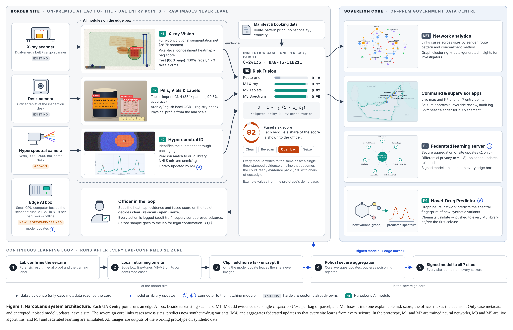

# NarcoLens

AI software that turns the UAE's existing customs X-ray scanners and inspection desks into one connected drug-detection network. Built for Presight Eureka 3.0 (Defense & Policing).

All data in this project is synthetic or simulated. The officer personas are fictional.

## Architecture



High-resolution PNG and vector PDF: [`docs/architecture/`](docs/architecture/). The figure is built from `docs/architecture/src/architecture.html`; every image in it is an output of the prototype.

## What's here

| Folder / file | What it is |
|---|---|
| `narcolens-prototype/` | The clickable prototype (plain HTML/CSS/JS, runs offline). See its README for the judge walkthrough. |
| `narcolens-ml/` | Training code for the M1 X-ray and M2 tablet models that run live in the prototype |
| `narcolens-screenshots/` | Screenshots for the submission |
| `narcolens-pitch-deck.pptx` / `.pdf` | Pitch deck with speaker notes |
| `docs/architecture/` | System architecture figure (PNG, PDF and editable source) |
| `dev-server.py` | Local dev server with live reload |

## Run it locally

You only need Python 3.

```bash
python3 dev-server.py
```

Open http://localhost:8080. The page reloads by itself whenever you save a file in `narcolens-prototype/`.

Demo sign-in: officer `MOHAP-DC-0427` / `demo`, or supervisor `DC-SUP-0112` / `demo`.

You can also open `narcolens-prototype/index.html` directly in a browser.

## Make the submission zip

```bash
cd narcolens-prototype && zip -r ../narcolens-prototype.zip index.html css js README.md
```
